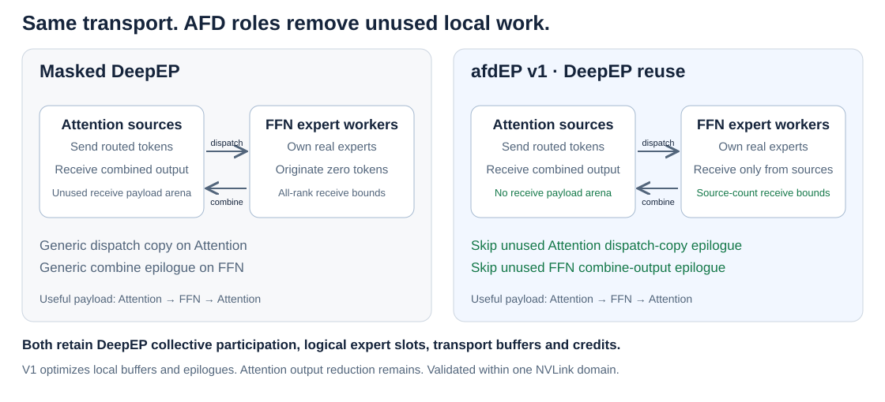

# afdEP

Expert-parallel communication for **Attention–FFN Disaggregation**:
N Attention token sources exchange work with M FFN expert workers.



**V1 reuses DeepEP V2 dispatch/combine.** Explicit AFD roles eliminate unused
Attention receive payloads and empty-side epilogues; FFN receive tensors are
bounded by Attention source count. The collective protocol, logical expert
slots, registered transport capacity and required synchronization remain.

**v2.1 (in progress) specializes those kernels for AFD**, measured against
Masked DeepEP: [changes and communication-only evidence](docs/v2.1.md).

## Use

Linux, PyTorch ≥2.6, CUDA toolkit with `nvcc`, and NCCL ≥2.30.7 with device
headers are required. The validated toolchain is in [validation](docs/validation.md).

```bash
pip install .
# Set these before starting Python; select the same NCCL headers and runtime.
export AFDEP_NCCL_ROOT=/path/to/nccl
export LD_LIBRARY_PATH="$AFDEP_NCCL_ROOT/lib:$LD_LIBRARY_PATH"
# For a single NVLink domain, without network communication:
export EP_DISABLE_GIN=1
python -m afdep doctor --build
```

```python
from afdep import Buffer, Config

# Set the CUDA device and initialize a CPU Gloo group first.
# Group ranks [0, 2) own experts; [2, 4) originate tokens.
comm = Buffer(
    group=group,
    config=Config(
        capacity_tokens_per_rank=2048,
        hidden_size=4096,
        num_experts=128,
        top_k=8,
        ffn_ranks=2,
        attention_ranks=2,
    ),
)
if comm.role == "attention":
    comm.source_dispatch(x, expert_ids, weights, bucket=2048)
    output = comm.source_collect()
else:
    received = comm.worker_receive(bucket=2048)
    weighted_rows = run_experts(received)  # Caller applies each routing weight once.
    comm.worker_reply(weighted_rows, received.receipt)
comm.close()  # Collective, after all exchanges and graph replays finish.
```

Routing, quantization and expert computation belong to the caller. BF16 and
prequantized FP8 dispatch return BF16 combined outputs. See the
[tensor, graph and lifecycle contract](docs/api.md).

## Support

| Architecture | Evidence | Current v1 scope |
|---|---|---|
| Hopper (SM90) | H100 GPU suite; H200 two-domain suite | BF16/FP8; eager/CUDA graphs; one NVLink domain, or two joined by GIN |
| Blackwell | Not validated | No support claim yet |
| Other architectures | Not validated | No support claim yet |

v1 validation uses 2 Attention + 2 FFN ranks with partitioned experts. The v2.1
role path is also validated with 3 Attention + 1 FFN and 1 Attention + 3 FFN in
one four-GPU NVLink domain ([evidence](docs/validation-v2.1-clean.json)), and
across two to four NVLink domains of two H200 GPUs (up to 8 ranks), and four and five single-GPU domains, joined by InfiniBand GIN (FFN domain +
Attention domain, plus 3:1 and 1:3 layouts that mix roles in a domain;
[evidence](docs/validation-v2.1-cross-node.json)). When each domain holds a single
role, a directional hybrid protocol is 17% (two nodes) to 21% (three nodes) faster than Masked at one token
([evidence](docs/validation-v2.1-directional-hybrid.json)); mixed-role domains keep
DeepEP's hybrid protocol. Other group layouts and larger multi-domain worlds
require validation.
`allow_hybrid_mode` retains DeepEP's meaning; it does not enable an unvalidated
topology.

[Validation](docs/validation.md) · [Contributing](CONTRIBUTING.md) ·
[Licenses and provenance](THIRD_PARTY_NOTICES.md)
