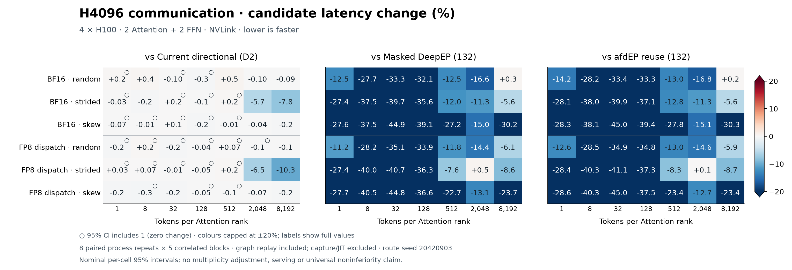
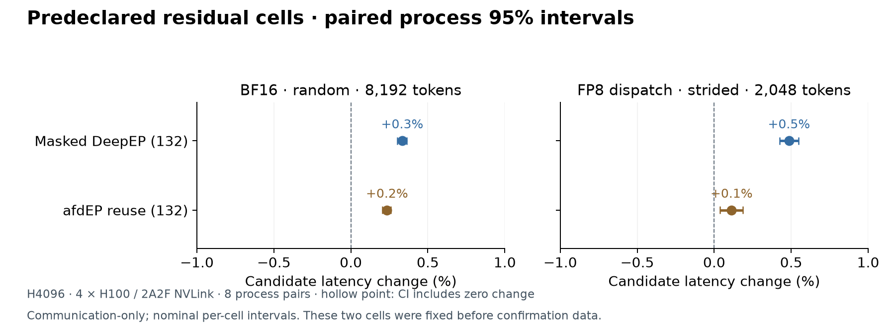
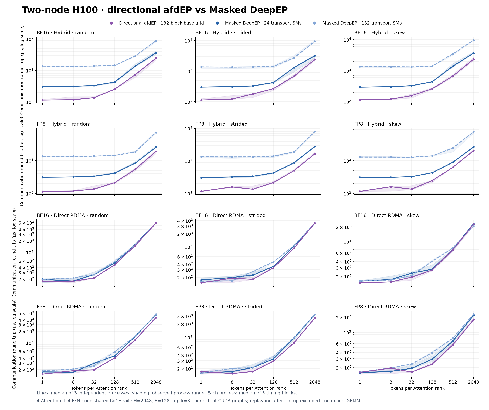
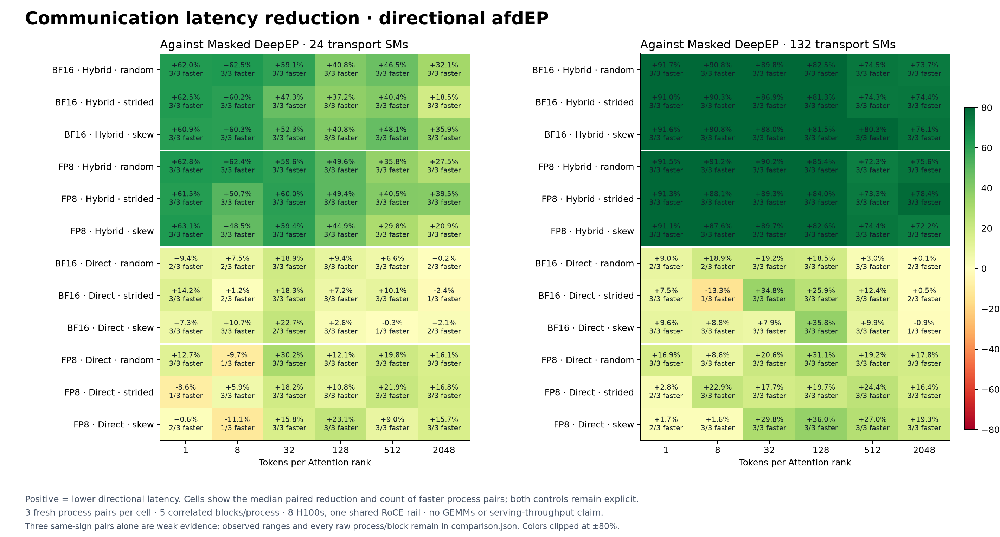
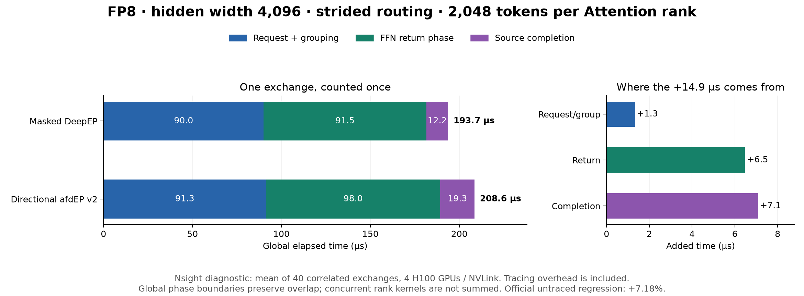

# Directional v2 · H100 experiments

**Independent communication tests:** four H100s, one NVLink domain,
2 Attention + 2 FFN, 128 experts, top-k 8. Each width has 90 fresh processes:
BF16/FP8 × three route patterns × five implementations × three balanced repeats.

| Hidden width | vs Masked24 | vs Masked132 | vs v1 reuse24 | vs v1 reuse132 |
|---|---:|---:|---:|---:|
| 2,048 | −18.5% | −14.2% | −19.4% | −15.4% |
| 4,096 | −32.1% | −24.9% | −32.6% | −25.3% |

Latency changes are equal-cell geometric means; negative is faster.
The 24/132 settings control DeepEP transport SMs; its local epilogues use the
full GPU. V2 uses a 132-block base grid. These are distinct launch policies.


H2048 has two near-ties against Masked132, including a 0.2% median slowdown.
H4096 has four consistently slower cells against Masked132: BF16 random/8,192
**+0.3%**, BF16 strided/8,192 **+2.5%**, FP8 strided/2,048 **+7.2%**, and
FP8 strided/8,192 **+1.9%**. The FP8 strided diagnosis is below.
Three process pairs support descriptive observed ranges; they do not establish
universal non-degradation or serving gains.

Registered capacity falls **63–69%** across these configurations. At H4096,
capacity 8,192/source, it totals **386 vs 1,040 MiB** in BF16 and
**324 vs 1,032 MiB** in FP8 across four ranks. This excludes expert/receive
tensors, caller allocations and total VRAM.

## Guarded wide replies · eight-pair confirmation

This experimental NVLink path skips empty FFN reply stores when the Attention
collector explicitly selects participating workers. Credits and lifetimes remain unchanged.
Four H100s, hidden width 4,096, 2 Attention + 2 FFN: **192 fresh-process jobs**,
eight paired repeats per configuration, five correlated timing blocks per process.



Against Masked132 and reuse132, **40/42 cells are nominally faster**. The two
remaining Masked132 regressions are BF16 random/8,192 **+0.334%** and FP8
strided/2,048 **+0.486%**. Against current directional D2, large strided cells
improve **5.7–10.3%**; overall, 14 cells are nominally faster, 26 inconclusive
and two slower. No universal non-degradation or serving claim follows.



[All 210 fixed contrasts, process medians, block timings and source hashes](validation-wide-replies-2026-10-20.json).
Candidate `125778b`; D2 control `8262b20`. Route seed 20,420,903; earlier screens
are not pooled. Per-extent graph replay is timed; capture/JIT/GEMMs are excluded.
Intervals are nominal per-cell 95% paired-log bootstrap intervals, without a
multiplicity adjustment. The published serving comparisons retain the D2 source.

## Two-node communication





Eight H100s, 4 Attention + 4 FFN, one shared RoCE rail: **108 processes**,
three fresh pairs per configuration. Against Masked24, hybrid latency falls
**18.5–62.5% BF16** and **20.9–63.1% FP8** across the tested cells; every pair
is faster. Direct mode is mixed: 10/18 BF16 and 14/18 FP8 cells are faster in
all three pairs. Some median regressions remain, with signs changing between
repeats. Both fixed controls and the frozen training policy remain in the data.

Registered capacity falls **70–74% in hybrid** and **50–62% in direct** mode.
These are communication-only, per-extent graph tests with replay included;
they do not measure serving throughput or establish universal non-degradation.

## Where time goes



For FP8 strided/2,048, the separate diagnostic gap is 14.9 µs: request/grouping
**+1.3 µs**, FFN return **+6.5 µs**, source completion **+7.1 µs**. V2 collection
starts 4.2 µs after the final FFN return; Masked overlaps it by 0.4 µs.
The collection body takes 15.0 vs 12.6 µs. Return/collection scheduling is the
next optimization target; kernel spans include waits and do not establish a
bandwidth or occupancy cause.


At 8,192 BF16 tokens, request/grouping is about 63 µs slower, return 64 µs faster
and source completion 7 µs slower in Nsight phase medians. Increasing the source
packing grid from 132 to 528 blocks cut its kernel from **90 to 58 µs**; device
instructions are unchanged. Worker packing starts at about the same time as
Masked DeepEP but still takes about 64 µs longer. Intervals include waits and
overlap, so they do not isolate network time or count bookkeeping.

Initialization, JIT and capture are excluded; **graph replay is included**.
Timing uses a graph per token extent, not one maximum-capacity graph. Expert
GEMMs are outside the timed path. Nsight runs are separate from latency runs.
This source passed 36 focused NVLink jobs and eight two-node GIN configurations,
covering BF16/FP8, eager/graphs, changing counts/routes, numerical edges and
delayed/poisoned reuse. Its parent kernel base passed 75 jobs, including three
expected invalid-input rejections. Exact source hashes are recorded below.

[All process/block measurements, source hashes and scope](validation-directional-2026-10-19.json)
· [Earlier H2048 record](validation-nvlink-2026-10-19.json)
· [Harness](../benchmarks/nvlink.py).

Use the [GPU environment](../README.md#use) and `EP_DISABLE_GIN=1`. Run each
payload/backend combination in a fresh four-rank process three times:

```bash
torchrun --standalone --nproc-per-node=4 -m benchmarks.nvlink \
  --backend directional --payload bf16 --hidden 4096 --capacity 8192 \
  --tokens 1 8 32 128 512 2048 8192 --routing random --routing-seed 59101 \
  --sms 132 --masked-sms 132 --warmup 1000 --iterations 1000 --repeats 5 \
  --output result.json
```

Use `--backend masked` or `--backend reuse` with `--masked-sms 24` or `132` for
the controls; repeat with FP8 and strided/skew routing. H2048 uses capacity
2,048, seed 49,001 and omits the 8,192 bucket. The two-node setup, frozen policy
and every process/block measurement are in the validation JSON above.
The separate [four-connector vLLM serving comparison](https://github.com/ms-llmd/afd-plugin/pull/31)
includes expert compute, scheduling and runtime graph replay.
