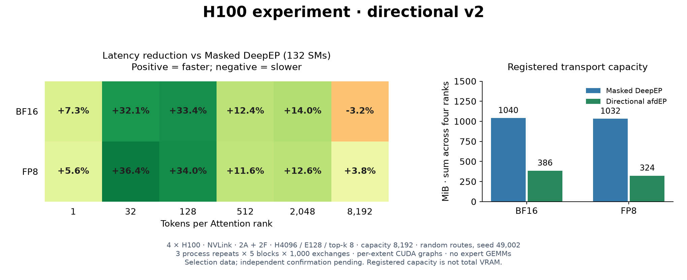

# Directional v2 · H100 experiment

**Selection results, not yet independent confirmation.** Four H100s in one NVLink
domain: 2 Attention + 2 FFN, H4096, 128 experts, top-k 8, capacity 8,192/source.
Three fresh processes per implementation and payload; each measures five blocks
of 1,000 exchanges after 1,000 warmups. Random routes use seed 49,002.



The control is **Masked DeepEP with 132 transport SMs** (`role_aware=False`).
V2 reuses source counts, vectorizes collection, specializes payload packing and
schedules contiguous return copies. At 2,048 tokens/source latency is 14.0% lower
in BF16 and 12.6% lower in FP8. At 8,192, BF16 remains **3.2% slower** and FP8 is
3.8% faster. These selection results do not establish non-degradation against
tuned Masked DeepEP, v1 reuse, other routes or serving workloads.

Registered transport capacity totals **386 vs 1,040 MiB** in BF16 and
**324 vs 1,032 MiB** in FP8 across four ranks. This measures logical registered
capacity, not total VRAM or all caller allocations.

## Where time goes


At 8,192 BF16 tokens, Nsight phase medians show request/grouping about 96 µs
slower, return about 64 µs faster and source completion about 6 µs slower.
The source packing/count kernel takes about 90 µs. Worker packing begins about
32 µs later and takes about 64 µs longer. Masked DeepEP overlaps dispatch with
its copy epilogue; the 90 µs is not entirely additional latency. Intervals include
waits and overlap, so they do not isolate network time or count bookkeeping.

Initialization, JIT and capture are excluded; **graph replay is included**.
Timing uses a graph per token extent, not one maximum-capacity graph. Expert
GEMMs are outside the timed path. Nsight runs are separate from latency runs.
This source passed 75 NVLink GPU jobs covering BF16/FP8, eager/graphs, numerical
edges, changing counts/routes, empty/skewed/asymmetric storage, poisoned slots,
delayed reuse and mixed collectors, including three expected invalid-input rejections.

[Full six-bucket measurements, source hashes and scope](validation-directional-2026-10-19.json)
· [Earlier H2048 record](validation-nvlink-2026-10-19.json)
· [Harness](../benchmarks/nvlink.py).

Use the [GPU environment](../README.md#use) and `EP_DISABLE_GIN=1`. Run each
payload/backend combination in a fresh four-rank process three times:

```bash
torchrun --standalone --nproc-per-node=4 -m benchmarks.nvlink \
  --backend directional --payload bf16 --hidden 4096 --capacity 8192 \
  --tokens 1 32 128 512 2048 8192 --routing random --routing-seed 49002 \
  --sms 132 --masked-sms 132 --warmup 1000 --iterations 1000 --repeats 5 \
  --output result.json
```

Use `--backend masked` for the fixed control or `--backend reuse` for v1.
BF16/FP8, tuned controls and independent routes need matched confirmation on
the final selected source; two-node GIN settings are being evaluated separately.
