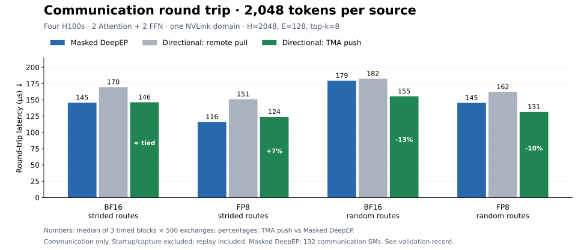

# Historical directional H100 experiment

## October 19: one NVLink domain

Four H100s, **2 Attention + 2 FFN**, H=2048/E=128/top-k=8. The directional
NVLink backend adapts DeepEP's warp reduction and TMA primitives: workers reduce
into shared memory and push replies to source-owned slots. Attention reduces locally.
The earlier remote-pull version waited for complete worker partials before reading them.

At 2048 tokens/source, random-route latency fell 13% in BF16 and 10% in FP8
against Masked DeepEP with 132 communication SMs. Strided-route BF16 was tied;
FP8 remained 7% slower. These are communication-only screens. Graph startup is
excluded; replay is included. Two independent directional processes agreed;
no serving/GEMM overlap gain is established.

Nsight's random-route BF16 source final-reduction kernel fell **49→9 µs**;
worker reduction plus TMA return took 54 µs, versus 46 µs for reduction alone.
Those kernel medians are not additive cross-rank critical-path measurements.
An additional zero-reply-elision variant passed correctness but slowed random
routes; it was rejected. Excess payload alone did not establish the latency cause.

The selected protocol passed 12 BF16/FP8 eager/graph configurations and three
invalid-input guards, including changing device counts, empty/skewed routes,
asymmetric source storage, delayed-reader reuse, and mixed-payload buffer lifecycles. Registered logical capacity
summed to 48.4 MiB BF16 / 40.6 MiB FP8 across four ranks; this is not total VRAM.
The eight-rank GIN path was not rerun.

[Configuration, timings, source/trace hashes and checks](validation-nvlink-2026-10-19.json)
· [Reproducible harness](../benchmarks/nvlink.py).
Run `torchrun --standalone --nproc-per-node=4 -m benchmarks.nvlink` with
`--backend directional --payload bf16 --tokens 2048 --routing random --iterations 500 --output result.json`.
For the unspecialized baseline, use `--backend masked --masked-sms 132`
(`role_aware=False`); `--backend reuse` selects the v1 role specialization.
Use the [GPU environment](../README.md#use) and `EP_DISABLE_GIN=1` here.

These records predate the integration onto v1. They do not measure the new
v1 role-specialized baseline; matched post-integration GPU runs are pending.
