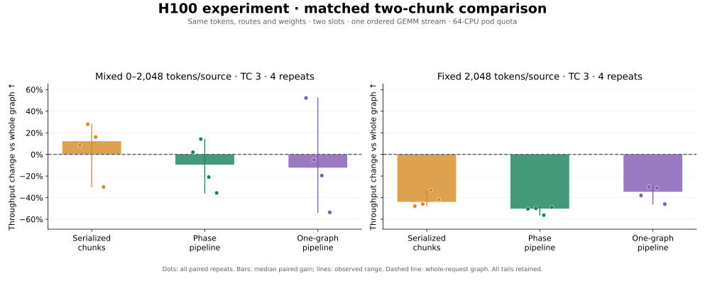
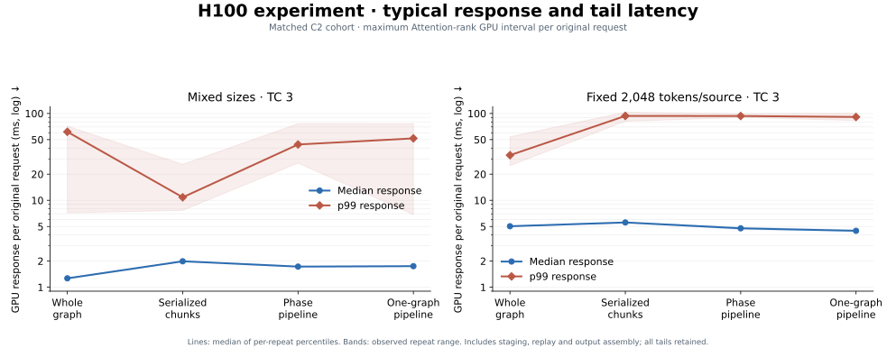
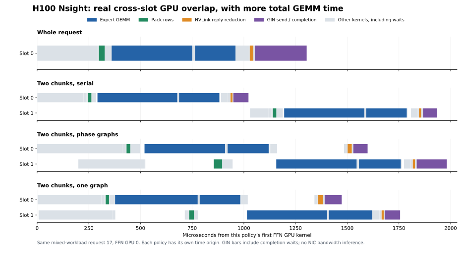
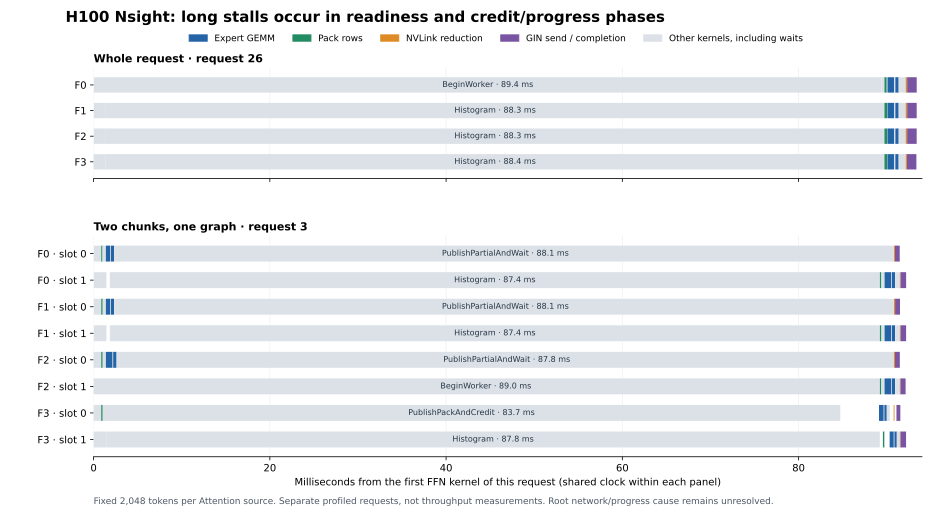

# Coordinated microbatch overlap

Two H100 nodes: four Attention sources, four FFN workers, and **one BF16 DeepGEMM
SwiGLU layer**. Overlap is within an original request; Attention computation and
serving scheduling are excluded.

| Variant | Execution |
|---|---|
| `whole_graph` | One maximum-capacity slot and receive → GEMMs → reply graph |
| `split_serial` | Two chunks, separate phase graphs, completed serially |
| `pipeline` | Same chunks; receive/reply overlap one ordered GEMM stream |
| `pipeline_graph` | Same two slots; one captured concurrent GPU DAG per request |

Slots share weights and own separate transport state, receive pools, and arenas.

**No consistent throughput win.** At 2,048 tokens/source, `pipeline_graph` reduced median
GPU response by approximately **11%**, but median paired throughput fell
**34.6%** versus `whole_graph` (traffic class 3). A separate class-0 control fell
**37.0%**; long stalls remained. Mixed-size gains were inconsistent.









With `pipeline_graph`, nonempty reply-kernel intervals overlap **3.19–4.50% of
GEMM time per FFN GPU** (large) and **6.35–6.76%** (mixed); whole/serial have
zero. Total GEMM time rises
**1.38–1.43× / 1.72–1.80×**, respectively. Intervals include GIN flush waits,
not wire-only transfer. Approximately 90 ms stalls occur in readiness/credit/
completion, with no GEMM above 30 ms; their cause remains unresolved. Short
profiles do not establish tail frequency. [Profile evidence](pipeline-nsight-digest.json).

Startup, weights, and resident-input generation are excluded; runtime staging,
replay, assembly, and completion are included. GPU response spans source
submission through assembled output, not serving latency. All CPU64 cases had
zero cgroup throttling; eight GPU validation jobs passed.
[Measurements and provenance](results-pipeline-h100.json) retain every tail and
keep sweeps, matched C2 runs, and traffic-class controls separate.

## Reproduce

Requires the optional [DeepGEMM backend](../prefill/README.md). Set `NODE_RANK`
and `MASTER_ADDR` per host: node 0 FFN, node 1 Attention. Use a 64-CPU quota per
four-GPU pod. H=2048, intermediate=4096, experts=128, top-k=8.

```bash
launch=(torchrun --nnodes=2 --nproc-per-node=4 --node-rank="$NODE_RANK"
  --master-addr="$MASTER_ADDR" --master-port=29501
  --module experiments.pipeline.benchmark
  --mode hybrid --capacity 2048 --microbatches 2 --slots 2
  --variants whole_graph split_serial pipeline pipeline_graph
  --num-sms 132 --rdma-traffic-class 3 --request-window 1
  --warmup 3 --repeats 4 --skip-correctness)
"${launch[@]}" --requests 900
"${launch[@]}" --requests 300 --fixed-tokens 2048
```

Use `--rdma-traffic-class 0` for the separate control. Omit
`--skip-correctness` for oracle checks; use `--nvtx --repeats 1` for separate profiles.
