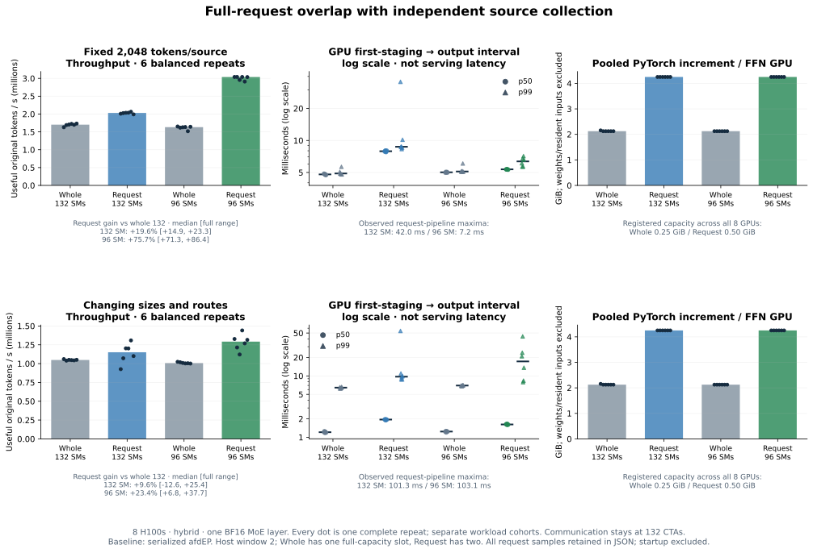
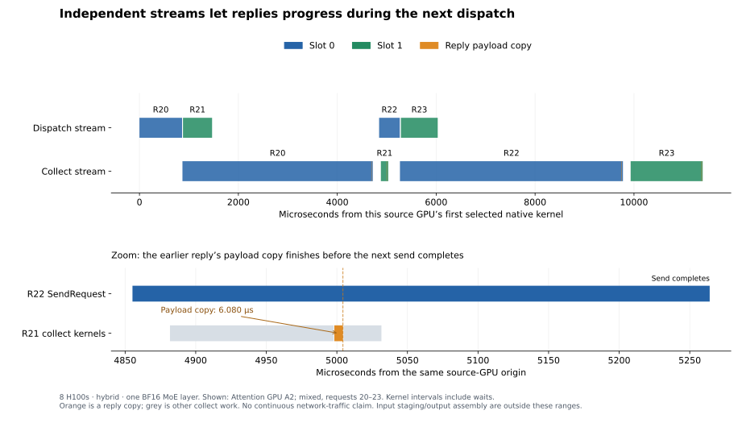

# Full-request overlap

Two H100 nodes, four Attention sources, four FFN workers, **one BF16 DeepGEMM
SwiGLU layer**. The baseline is serialized afdEP (`whole_graph`), not a new
Masked DeepEP comparison. Attention computation and serving scheduling are excluded.

| Variant | Scheduling |
|---|---|
| `whole_graph` | One full-capacity slot; complete each request |
| `request_serial` | Two full-capacity slots; same phase graphs, serial completion |
| `request_pipeline` | Two full-capacity slots; dispatch A/B, independently collect A; one GEMM stream |
| `pipeline_graph` | Two half-capacity chunks of one original request |

Full-size requests retain efficient GEMMs. A separate control found **21.6%**
extra FFN time when splitting identical expert rows. [GEMM evidence](gemm-only-control.json).



In **hybrid mode**, a 96-SM DeepGEMM budget improved throughput in all six repeats:
**71.3–86.4%** (median **75.7%**)
for 2,048 tokens/source and **6.8–37.7%** for changing sizes/routes. Mixed requests
still reached **103 ms**. Two full slots roughly double buffers: pooled FFN
tensors grow from 2.13 to 4.25 GiB/GPU. The budget caps DeepGEMM's worker grid,
not a pinned physical SM partition.

The separate direct-mode control **lost 28.8% median throughput** (five of six
repeats); this optional caller-scheduled pipeline is not a general default win.

GPU first-staging → output intervals start earlier under pipelining and include
queueing; host completion upper bounds are stored separately. These are component
measurements, not serving latency.



Nsight confirms an earlier reply copy progresses while the next request sends.
Communication-kernel intervals overlap expert GEMMs, but include completion waits;
intermittent transport tails remain. [Profile evidence](profiles-final.json).

[All measurements and source hashes](results-pipeline-followup-h100.json) retain
every tail and keep diagnostic cohorts separate. Source fingerprint: `baf867082abf`.
The [historical slow run](results-pipeline-h100.json) recovered on fresh unchanged
transport; later changes do not establish its cause.
[Earlier budget sweep](pipeline-budget-history.svg) ·
[CPU/recovery controls](pipeline-recovery-history.svg).

## Reproduce

Requires the optional [DeepGEMM backend](../prefill/README.md), two four-GPU hosts,
and 64 CPUs/host. Set `NODE_RANK`/`MASTER_ADDR`; node 0 runs FFN.

```bash
export OMP_NUM_THREADS=1 NCCL_SET_THREAD_NAME=1
launch=(torchrun --nnodes=2 --nproc-per-node=4 --node-rank="$NODE_RANK"
  --master-addr="$MASTER_ADDR" --master-port=29501
  --module experiments.pipeline.benchmark
  --mode hybrid --capacity 2048 --microbatches 1 --slots 2
  --variants whole_graph request_pipeline --gemm-sms 132 96
  --num-sms 132 --request-window 2 --rdma-traffic-class 3
  --warmup 3 --repeats 6 --skip-correctness)
"${launch[@]}" --requests 900
"${launch[@]}" --requests 300 --fixed-tokens 2048
```

Startup/capture/input generation and teardown are excluded; runtime staging,
replay, and source-window drain are included. Omit `--skip-correctness` for
oracle checks; use `--nvtx` for separate profiles.
