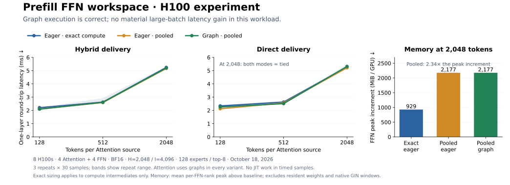

# Prefill workspace experiment

**Graph-compatible FFN execution works; large-prefill speedup is not established.**



Eight H100s: four Attention sources and four FFN workers. One synthetic BF16
SwiGLU layer uses real DeepGEMM grouped GEMMs: hidden 2048, intermediate 4096,
128 experts, top-8 routing. Attention uses the **same CUDA-graph execution** in
every variant.

| FFN variant | Receive counts | Compute intermediates |
|---|---|---|
| Eager exact compute | CPU wait | Allocate for actual aligned rows |
| Eager pooled | GPU only | Reuse bounded workspace |
| Graph pooled | GPU only | Replay with the same bounded workspace |

At 2048 tokens/source, graph and exact-compute latencies were **approximately
tied in both modes**. Pooling increased the mean per-FFN-rank allocator peak
increment from **929 to 2177 MiB**. Smaller gains were modest and variable.

Nsight guided the removal of unused-capacity scanning: pooled activation and
weighting kernel time fell from about **0.30 to 0.17 ms** in separate profiled
runs. [Stage measurements and provenance](results-h100.json) accompany the timings.

Each FFN GPU shares a bounded activation/intermediate pool among local experts.
GPU prefix sums partition it; **128-row alignment remains**. Receive and reply
storage is reused with afdEP's completion/credit protocol.

“Exact” applies **only to GEMM intermediates**; all variants reserve conservative
receive storage. Timings cover receive–compute–reply for one microbatch. This
optional experiment establishes neither serving performance nor a DeepEP
comparison.

## Run

Provision [afdEP/NCCL](../../docs/api.md) and the compatible DeepGEMM BF16 grouped
**psum** API recorded in [results-h100.json](results-h100.json). For a staged
extension, set `AFDEP_DEEPGEMM_MODULE` to its `.so` and `AFDEP_DEEPGEMM_ROOT` to
the matching `deep_gemm` source directory.

Run on both four-GPU hosts, with node 0 hosting FFN workers:

```bash
torchrun --nnodes=2 --nproc-per-node=4 --node-rank="$NODE_RANK" \
  --master-addr="$MASTER_ADDR" --master-port=29500 \
  --module experiments.prefill.benchmark --mode hybrid \
  --source-execution graph --tokens 128 512 2048 \
  --hidden 2048 --intermediate 4096 --experts 128 --top-k 8 \
  --correctness-epochs 2 --check-timed-output
```

Use `--mode direct` for direct delivery. Checks include PyTorch references,
changing/skewed/empty routes and delayed peers. Repeats rotate order and exclude
cold JIT. Profile separately with `--nvtx`.
