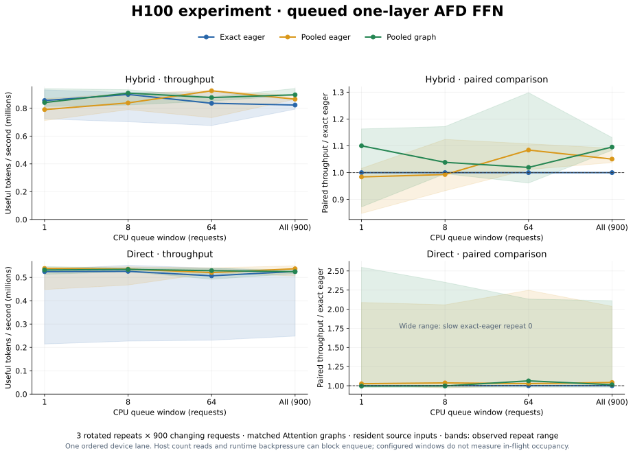

# Mixed-size FFN workspace experiment

**A backlogged hybrid stream benefits; graphs are not a universal throughput win.**



Eight H100s: four Attention + four FFN ranks; one BF16 DeepGEMM SwiGLU layer,
hidden 2048, intermediate 4096, 128 experts, top-8 routing.

| Variant | FFN storage | Execution |
|---|---|---|
| `dynamic_eager` | GPU counts → CPU wait → exact receive/intermediate allocations | Eager |
| `pooled_eager` | Reusable receive storage + shared FFN arena; GPU counts | Eager |
| `pooled_graph` | Same storage, six cached bucket graphs | CUDA graphs |

With **900 changing requests and a final-only drain**, hybrid graph/exact gains
were **8–13%** across three rotated repeats (median paired gain **9.6%**).
Pooled eager gained **4–9%**: preallocation contributes too. Direct graphs were
near parity in later repeats; the first exact-eager trace had large tails.
Other queue windows were less consistent; bands retain all repeats.
[Measurements, checks and provenance](results-sustained-h100.json).

Separate Nsight traces show FFN kernel gaps **68 → 1 µs**, with GEMM time
unchanged. Direct-mode long tails occur inside GIN/peer-wait kernels in eager
and graph runs; their cause remains unresolved.

All variants use identical graphed Attention sources and already-resident GPU
inputs. Window K means enqueue K requests, then drain; 0 submits the whole trace.
There is **one ordered device lane**; CUDA calls may still block submission.
Throughput includes submission and final
completion, excluding input generation, capture, instantiation and first replay.
This measures an always-ready **component**, not full serving throughput.

Each FFN GPU shares capacity among experts using GPU prefix sums; 128-row expert
alignment remains. Live token counts transfer actual source rows without bucket
wire padding. Exact eager usually allocates through PyTorch's cache; allocation
requests are not equivalent to physical device allocations.

## Run

Provision [afdEP/NCCL](../../docs/api.md) and the recorded DeepGEMM BF16 grouped
psum API. For a staged extension, set `AFDEP_DEEPGEMM_MODULE` to its `.so` and
`AFDEP_DEEPGEMM_ROOT` to the matching source directory.

Run on both four-GPU hosts; node 0 hosts FFN workers:

```bash
torchrun --nnodes=2 --nproc-per-node=4 --node-rank="$NODE_RANK" \
  --master-addr="$MASTER_ADDR" --master-port=29500 \
  --module experiments.prefill.serving --mode hybrid \
  --requests 900 --repeats 3 --live-token-count --cuda-events \
  --execution queued --source-policy matched_graph --queue-depth 0
```

Use `--mode direct`; sweep `--queue-depth 1`, `8`, `64`, `0`.
Profile separately with `--nvtx`.
Earlier controls: [closed loop](mixed-performance.svg)
([data](results-mixed-h100.json)), [fixed bucket](performance.svg)
([data](results-h100.json)).
