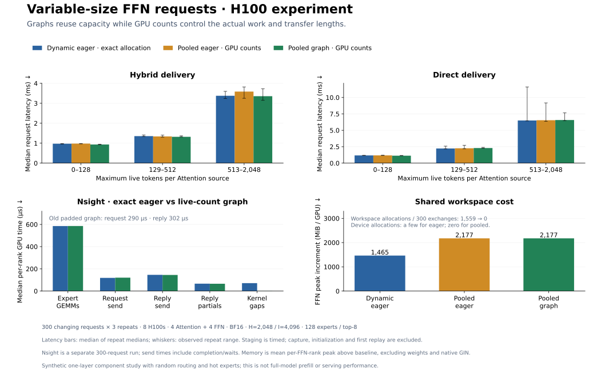

# Mixed-size FFN workspace experiment

**Fixed workspaces and GPU counts support changing requests; performance remains
mixed.**



Eight H100s, four Attention + four FFN ranks; one BF16 DeepGEMM SwiGLU layer:
hidden 2048, intermediate 4096, 128 experts, top-8 routing.

| Variant | Receive/compute storage | Execution |
|---|---|---|
| `dynamic_eager` | GPU counts → CPU wait → exact receive and intermediate allocations | Eager |
| `pooled_eager` | Reusable receive storage + one maximum-capacity FFN arena; GPU counts | Eager |
| `pooled_graph` | Same storage, six cached bucket graphs | CUDA graphs |

Each FFN GPU shares storage among its experts. GPU prefix sums partition it;
**128-row expert alignment remains**. A device live-token count sends **actual
source rows without bucket wire padding**, while graph storage stays fixed.

- Graph p50 latency: hybrid **1.347 → 1.314 ms**; direct **2.259 → 2.386 ms**.
  No overall throughput improvement.
- Pooling removes roughly **1,559 FFN allocation requests per 300 requests**.
  Dynamic eager mostly uses cached memory, with few physical device allocations.
- Mean FFN allocator peak increment: **1,465 → 2,177 MiB/GPU**. Resident weights
  and native GIN windows are excluded.

Nsight confirms comparable send stages after removing padding. Large tails
remain in GIN completion; their cause is unresolved.

Three rotated repeats use 300 mixed requests each: changing non-aligned batch
sizes, unseen random routing, hot workers and empty sources. Input staging is
timed; capture, instantiation and first replay are excluded. Input generation
is outside request latency but included in trace throughput. This is a
**closed-loop, single-layer component study**, not vLLM serving.
[Measurements, checks and provenance](results-mixed-h100.json).

## Run

Provision [afdEP/NCCL](../../docs/api.md) and the recorded DeepGEMM BF16 grouped
psum API. For a staged extension, set `AFDEP_DEEPGEMM_MODULE` to its `.so` and
`AFDEP_DEEPGEMM_ROOT` to the matching source directory.

Run on both four-GPU hosts; node 0 hosts FFN workers:

```bash
torchrun --nnodes=2 --nproc-per-node=4 --node-rank="$NODE_RANK" \
  --master-addr="$MASTER_ADDR" --master-port=29500 \
  --module experiments.prefill.serving --mode hybrid \
  --requests 300 --repeats 3 --live-token-count --cuda-events
```

Use `--mode direct` for direct delivery. Profile separately with `--nvtx`.
Historical fixed-bucket control: [figure](performance.svg), [results](results-h100.json).
