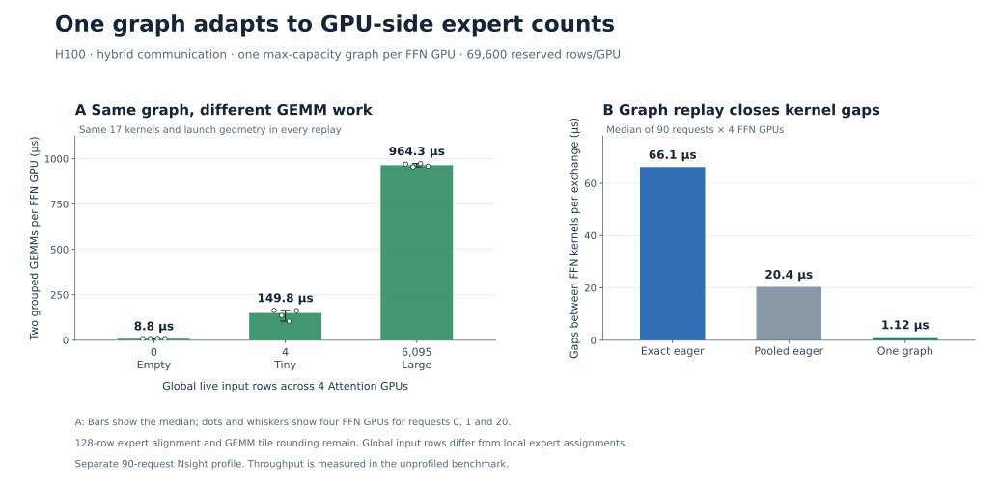

# Single-graph FFN workspace

**One maximum-capacity graph per FFN GPU, reused across changing token counts.**



The graph captures receive → GPU counts/packing → grouped GEMM → SwiGLU →
grouped GEMM → reduction/reply. Each worker shares one preallocated receive pool
and compute arena across its experts. Addresses stay fixed; GPU prefix sums
select active rows. Expert alignment and tile rounding remain. Unused capacity
is not transferred or fully computed. Capture once; **replay for every batch**.

| Variant | FFN storage/counts | Submission |
|---|---|---|
| `dynamic_eager` | CPU reads GPU counts; exact aligned allocation requests | Individual kernels |
| `pooled_eager` | Shared fixed pool; GPU counts | Individual kernels |
| `pooled_graph` | Same pool/counts | One captured graph |

On eight H100s, the longer hybrid comparison (9,000 requests × four balanced
repeats) shows **3.0% median paired throughput gain**. Gains were 14.7%, 2.9%,
3.0%, 3.0%; the first includes a slower eager trace, retained in full.
[Throughput](single-graph-performance.svg) ·
[Per-step GPU budget, milliseconds](single-graph-step-budget.svg) ·
[Measurements, Nsight and provenance](results-single-graph-h100.json).
Shorter hybrid/direct runs remain noisy; communication/readiness tails can
outweigh ordinary kernel-gap savings. No general 8–13% single-graph claim.

This is **one BF16 FFN layer**, not a full vLLM step. Attention communication is
already graphed in every variant; input staging remains outside it. All variants
use the same fixed GEMM tuning hint, not individually retuned eager kernels.
Capture, instantiation, first replay and resident input generation are excluded;
runtime staging/replay/completion are timed. One ordered device lane.

## Run

Provision [afdEP/NCCL](../../docs/api.md) and the recorded DeepGEMM BF16 grouped
psum API. Set `AFDEP_DEEPGEMM_MODULE`/`AFDEP_DEEPGEMM_ROOT` for a staged extension.
Run on both four-GPU hosts; node 0 hosts FFN workers:

```bash
torchrun --nnodes=2 --nproc-per-node=4 --node-rank="$NODE_RANK" \
  --master-addr="$MASTER_ADDR" --master-port=29500 \
  --module experiments.prefill.serving --mode hybrid --buckets 2048 \
  --requests 9000 --repeats 4 --warmup 10 \
  --variants dynamic_eager pooled_graph --live-token-count --cuda-events \
  --execution queued --source-policy matched_graph --queue-depth 0
```

The shorter control uses 900 requests, three repeats, all three variants,
`--mode hybrid`/`direct`, and queue windows 1/final-only. Profile separately with
`--nvtx`. H=2048, I=4096, E=128, top-k=8; fixed capacity=2048, GEMM hint=512.

Historical **six-bucket** [queued](results-sustained-h100.json) and
[closed-loop](results-mixed-h100.json) results remain frozen; reproduce with
`--buckets 1 8 32 128 512 2048`. [Earlier fixed control](results-h100.json).
